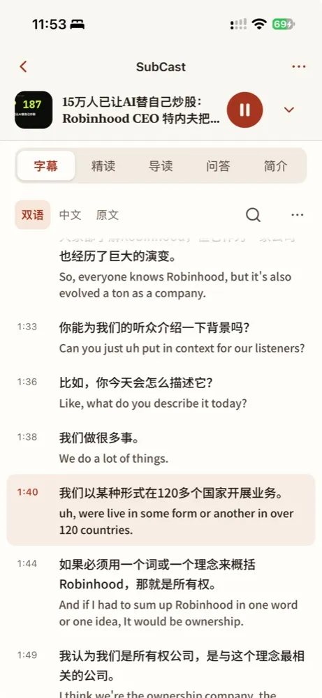

<div align="center">


# SubCast Mobile · 声渡手机版

**中文** | [English](#english)

**在手机上听懂海外播客和 YouTube：双语字幕、乔木精读、AI 导读和问答。**

Understand overseas podcasts and YouTube on your phone: bilingual subtitles, deep reads, AI summaries and Q&A.

[](LICENSE)


[](https://github.com/joeseesun/subcast)



</div>

## 这是什么

[SubCast 桌面版](https://github.com/joeseesun/subcast) 的 iOS / Android 版本。界面（React）和后端（Rust）是同一套代码，用 [Tauri 2](https://v2.tauri.app) 打包成手机 App，再按触屏重新设计了布局。

- 订阅 YouTube 频道、Apple Podcasts、小宇宙或任意 RSS。
- 有官方字幕就用官方字幕，没有就调用云端语音识别，再逐句翻译成中文，边听边对照。
- 内置乔木精读：精选播客有现成的中文精读、原文稿和豆包朗读。
- 看 AI 导读快速了解一期讲了什么，或者直接提问，回答里的时间戳点一下就跳回原话。

现在还没有上架应用商店（TestFlight 在准备中）。想用的话，按下面的步骤自己编译安装到手机上。

## 核心能力

| 能力 | 你得到什么 |
|---|---|
| 订阅 | YouTube 频道、Apple Podcasts、小宇宙、RSS；支持 OPML / YouTube Takeout 文件导入 |
| 字幕 | 官方字幕 → 共享字幕 → 云端识别（DeepSeek、豆包、硅基流动、Groq、OpenAI、智谱、阶跃…） |
| 翻译 | 谷歌免费翻译，或用自己的模型；双语、只看中文、只看原文三种视图 |
| 乔木精读 | 十几个精选播客站的中文精读和原文；新节目带逐句时间戳 |
| AI 导读与问答 | 用你自己的 API Key，回答带可点击的时间戳 |
| 播放 | 后台播放、锁屏 / 控制中心 / 通知栏控制；iOS 全屏视频也有双语字幕 |
| 其他 | 收藏连播、离线下载、收听统计、金句海报、四种界面语言（简中 / 繁中 / 英 / 日） |

### 和桌面版的区别

| | 桌面版 | 手机版 |
|---|---|---|
| 语音识别 | 本机 Qwen3-ASR / Whisper，或云端 | **只用云端**（DeepSeek 默认，和问答共用 Key） |
| AI 模型 | API Key，或本机 Claude Code / Codex 等 | **只用 API Key** |
| YouTube 播放 / 取音频 | yt-dlp | InnerTube 直链（iOS 用 HLS，音频按 8 MB 分段下载） |
| API Key 存放 | 系统钥匙串 | iOS 钥匙串；Android 应用私有目录（`keys.json`，权限 600） |
| 界面 | 侧栏 + 三栏 | 底部标签栏；单集页上方播放器，下方「字幕 / 精读 / 导读 / 问答 / 简介」 |
| 更新 | 自动更新 + 界面热更新 | 走应用商店 / TestFlight，没有热更新 |

## 安装到手机

### 准备

- macOS（编 iOS 必须）或 macOS / Linux / Windows（只编 Android）
- Node 20+、[Rust](https://rustup.rs)
- iOS：Xcode 16+，一个 Apple ID（免费账号就能装到自己手机，7 天后要重新装；付费开发者账号是一年）
- Android：Android Studio（带 SDK、NDK）、JDK 17+

```bash
git clone https://github.com/joeseesun/subcast-mobile.git
cd subcast-mobile
npm install
```

### iOS（iPhone / iPad）

1. 装 Rust 的 iOS 目标：

   ```bash
   rustup target add aarch64-apple-ios aarch64-apple-ios-sim
   ```

2. **换成你自己的签名。** 仓库里写的是作者的团队和 Bundle ID，你的 Apple 账号用不了：
   - 打开 `src-tauri/tauri.conf.json`，把 `identifier` 改成你自己的（例如 `com.yourname.subcast`），把 `bundle.iOS.developmentTeam` 改成你的 Team ID。
   - 用 Xcode 打开 `src-tauri/gen/apple/subcast-mobile.xcodeproj`，在 **Signing & Capabilities** 里选你的 Team，把 Bundle Identifier 改成同一个值。
   - Team ID 可以在 Xcode → Settings → Accounts 里看到，也可以在 [developer.apple.com/account](https://developer.apple.com/account) 的 Membership 里找到。

3. 先在模拟器里试：

   ```bash
   npm run ios          # 等于 npx tauri ios dev
   ```

4. 装到真机：手机用线连 Mac，在手机上打开 **设置 → 隐私与安全性 → 开发者模式**，然后：

   ```bash
   npx tauri ios build --export-method debugging
   # 生成的 .ipa 在 src-tauri/gen/apple/build/arm64/ 下
   ```

   也可以直接在 Xcode 里选中你的手机，点运行。第一次打开时，如果提示「不受信任的开发者」，到 **设置 → 通用 → VPN 与设备管理** 里信任你自己的证书。

### Android

1. 设置环境变量（路径按你自己的 Android Studio 安装位置改）：

   ```bash
   export ANDROID_HOME="$HOME/Library/Android/sdk"          # Linux 一般是 ~/Android/Sdk
   export NDK_HOME="$ANDROID_HOME/ndk/$(ls $ANDROID_HOME/ndk | tail -1)"
   rustup target add aarch64-linux-android armv7-linux-androideabi x86_64-linux-android i686-linux-android
   ```

2. 模拟器里试：`npm run android`

3. 打一个能直接装的 APK（用调试证书签名）：

   ```bash
   npx tauri android build --apk --debug
   adb install -r src-tauri/gen/android/app/build/outputs/apk/universal/debug/app-universal-debug.apk
   ```

   也可以把 APK 发到手机上直接点开安装（要允许「安装未知应用」）。

4. 如果要发给别人或上架，在 `src-tauri/gen/android/app/build.gradle.kts` 里把 `applicationId` 改成你自己的，生成自己的 keystore 配 `signingConfigs`（keystore 不要放进仓库）。

### 第一次打开

1. **设置 → 语音识别 / AI 模型**，填一个 API Key。最省事的是 [DeepSeek](https://platform.deepseek.com)：识别和问答共用一个 Key。只看有官方字幕的视频、只用乔木精读的话，可以不填。
2. 在「发现」里订阅乔木精读的播客，或者搜索、粘贴 YouTube / 播客链接。

## 改造指南

想基于这个项目做自己的版本，先看这几处：

```
src/                           前端（React + TypeScript；mobile.css 是手机布局）
src/components/MobileNav.tsx   底部标签栏、订阅页
src/lib/nowplaying.ts          锁屏 / 通知栏的播放信息和按钮
src/locales/                   界面翻译（en / ja / zh-TW；中文写在代码里）
src-tauri/src/                 Rust 后端：订阅、字幕、识别（cloud.rs）、YouTube（youtube.rs）、乔木精读（qiaomu.rs）
plugins/mobile/                原生插件：iOS Swift、Android Kotlin（后台音频、锁屏控制、分享）
src-tauri/gen/apple, android   Xcode / Gradle 工程
```

- 改完跑这三项检查：`npx tsc --noEmit -p .`、`npm run i18n -- --strict`、`cd src-tauri && cargo test --lib`。
- 新增界面文字写成 `t("中文")`，再到 `src/locales/{en,ja,zh-TW}.ts` 补翻译。
- 新增 Tauri 命令要改四处：Rust 函数、`invoke_handler`、`src-tauri/build.rs` 的 COMMANDS、`capabilities/default.json`。
- 常见的坑（WebView、iOS 全屏、Android 安全区等）写在 [AGENTS.md](AGENTS.md) 里，用 AI 编程工具改代码时它也会先读这个文件。
- 欢迎提 issue 和 PR。

<details>
<summary>开发时用文件驱动模拟器</summary>

`npm run ios` 期间，往 `public/__nav.json` 写内容，App 就会跳转或执行一段脚本；WebView 的 console 输出写在 `/tmp/subcast-webview.log`：

```bash
echo '{"n":1,"go":{"kind":"discover"}}' > public/__nav.json
echo '{"n":2,"episode":0}' > public/__nav.json     # 打开第一集
echo '{"n":3,"click":".m-ep-top .play-btn"}' > public/__nav.json
```

`n` 每次都要换一个值。这个功能只在 `vite dev` 下生效，正式包里没有。

</details>

## 隐私与边界

- API Key 只存在手机上（iOS 钥匙串 / Android 应用私有目录），只发给你选的服务商。
- 这几项功能会连到作者的服务器：
  - 乔木精读的内容来自 `*.qiaomu.ai` 和 `rss.qiaomu.ai`。
  - 共享字幕默认开启，会把识别好的字幕文本匿名上传到 `subcast.qiaomu.ai`（带一个随机安装编号，不含音频），可以在设置里关掉。
  - 你自己的分支可以继续用这些服务，也可以把相应地址改掉。
- YouTube 播放用的是 InnerTube 直链，离线下载会保存音频。如果要上架应用商店，请先评估这两项是否符合商店政策，必要时在商店版里关掉。
- 目前主要在 iPhone 上测试；Android 能编译运行，但实机测试比 iOS 少。

## 许可

[AGPL-3.0-only](LICENSE)，和桌面版相同。可以自由修改和分发；如果把修改后的版本发布出去，或者作为网络服务提供给别人用，也需要按 AGPL 公开你的源代码。

## 关于作者

向阳乔木 · [qiaomu.ai](https://qiaomu.ai) · [博客](https://blog.qiaomu.ai) · [推荐](https://tuijian.qiaomu.ai) · X [@vista8](https://x.com/vista8) · GitHub [@joeseesun](https://github.com/joeseesun) · 公众号「向阳乔木推荐看」

---

<a name="english"></a>

# English

**SubCast Mobile** is the iOS / Android build of the [SubCast desktop app](https://github.com/joeseesun/subcast): the same React interface and Rust backend, packaged with [Tauri 2](https://v2.tauri.app) and redesigned for touch.

- Subscribe to YouTube channels, Apple Podcasts, Xiaoyuzhou or any RSS feed.
- Official captions when they exist, otherwise cloud speech recognition (DeepSeek, Doubao, SiliconFlow, Groq, OpenAI, Zhipu, StepFun…), translated sentence by sentence.
- Curated "Qiaomu deep reads": Chinese deep reads, transcripts and read-aloud for selected podcasts.
- AI summaries and Q&A with your own API key; timestamps in answers jump back to the source.
- Background playback, lock-screen and notification controls, bilingual subtitles in iOS full screen, offline downloads, four interface languages.

It is not in the app stores yet (TestFlight is being prepared), so build it yourself:

```bash
git clone https://github.com/joeseesun/subcast-mobile.git && cd subcast-mobile && npm install
```

**iOS** (macOS + Xcode 16+; a free Apple ID works for your own phone, re-install every 7 days):

1. `rustup target add aarch64-apple-ios aarch64-apple-ios-sim`
2. Use your own signing: set `identifier` and `bundle.iOS.developmentTeam` in `src-tauri/tauri.conf.json`, and pick your team and the same bundle ID in Xcode (`src-tauri/gen/apple/subcast-mobile.xcodeproj` → Signing & Capabilities).
3. Simulator: `npm run ios`. Device: enable Developer Mode on the phone, then `npx tauri ios build --export-method debugging`, or run from Xcode.

**Android** (Android Studio with SDK + NDK, JDK 17+):

1. Set `ANDROID_HOME` and `NDK_HOME`, then `rustup target add aarch64-linux-android armv7-linux-androideabi x86_64-linux-android i686-linux-android`.
2. Emulator: `npm run android`. Installable APK: `npx tauri android build --apk --debug`, then `adb install -r <apk>`.
3. For distribution, change `applicationId` in `src-tauri/gen/android/app/build.gradle.kts` and sign with your own keystore (never commit it).

**First run:** add an API key under Settings (a [DeepSeek](https://platform.deepseek.com) key covers both transcription and Q&A). Videos with official captions and the deep reads work without one.

**Hacking on it:** see the layout and checks above (`npx tsc --noEmit -p .`, `npm run i18n -- --strict`, `cd src-tauri && cargo test --lib`) and the pitfalls in [AGENTS.md](AGENTS.md).

**Privacy and limits:**
- API keys stay on the device.
- Deep reads come from `*.qiaomu.ai`. Shared subtitles (on by default, can be turned off) upload transcript text anonymously to `subcast.qiaomu.ai`; forks may keep or replace these endpoints.
- YouTube playback uses InnerTube streams and offline downloads save audio; review store policies before shipping to an app store.
- Tested mostly on iPhone; Android builds and runs but has seen less device testing.

**License:** [AGPL-3.0-only](LICENSE), same as the desktop app.
